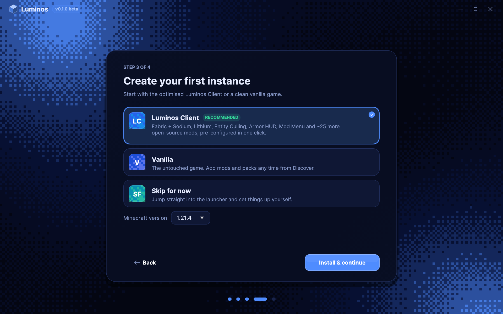

# Luminos Launcher

A light, fast, **all-Rust** Minecraft Java launcher with a dithered-blue identity, a built-in mod library,
auto-updating content, per-instance isolation, playtime tracking, a skin studio and the one-click **Luminos Client** bundle.


| Setup | Instance | Discover | Skin studio |
|---|---|---|---|
|  |  |  |  |

More screens: [`docs/screenshots/`](docs/screenshots) · Progress log: [`CONTINUITY.md`](CONTINUITY.md) · Research & ideas: [`docs/RESEARCH.md`](docs/RESEARCH.md) · Agent rules: [`AGENTS.md`](AGENTS.md)

## Run it
```bash
cd launcher
cargo run -p luminos-app --release
```
Needs a recent stable Rust toolchain. Java is detected or downloaded automatically.

## Layout
- `launcher/crates/luminos-core` – engine (no UI)
- `launcher/crates/luminos-app` – egui UI + `luminos-shots` headless screenshot renderer
- `src/` – Next.js marketing site, deployed to GitHub Pages by `.github/workflows/pages.yml`

## Legal
Independent project, not affiliated with Mojang or Microsoft. Luminos never bundles game files; it downloads them from Mojang's official servers at runtime. Offline accounts are supported for local/offline-mode play; please buy the game if you can.
Licence: GPL-3.0-or-later. Fonts Inter and JetBrains Mono are SIL OFL 1.1.
