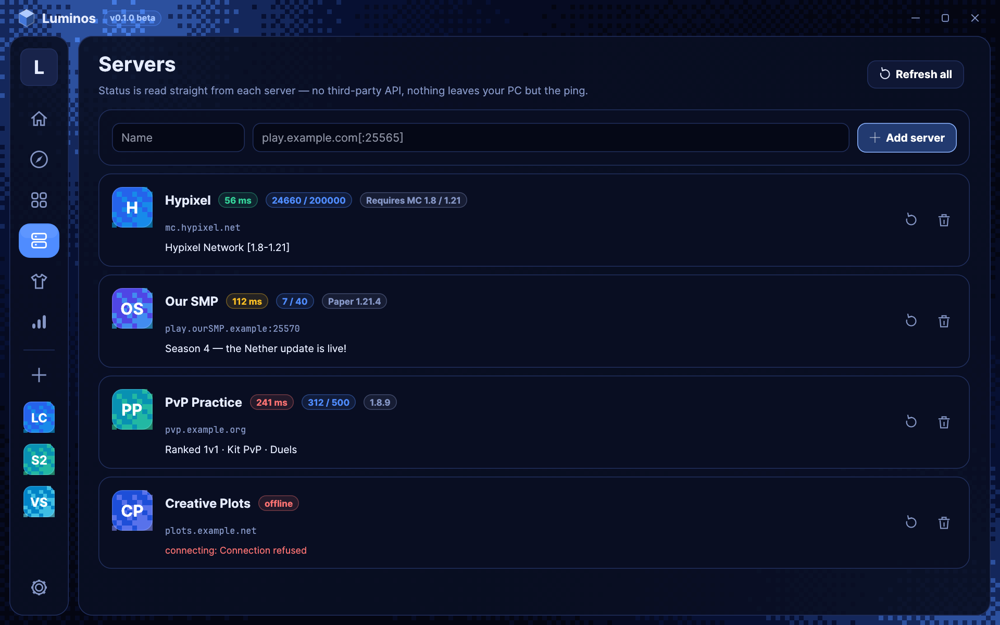
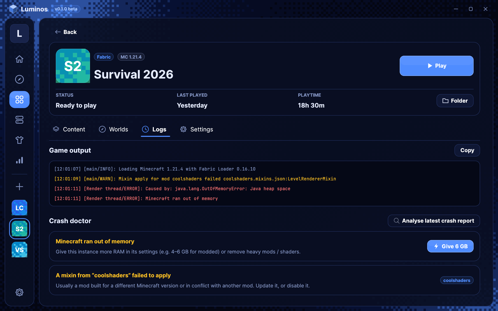

<div align="center">

# Luminos

**A featherweight, all-Rust Minecraft launcher — dithered-blue UI, built-in mod library, auto-updating content, playtime tracking, skin studio, and its own optimised in-game client.**

[Website](https://prashantchataut.github.io/Luminos/) · [Progress log](CONTINUITY.md) · [Research & ideas](docs/RESEARCH.md) · [Agent rules](AGENTS.md)


</div>

## Why Luminos
- **Tiny & fast** — 100 % Rust (`egui`), no Electron or webview, ≈ 11.6 MB release binary, near-zero idle CPU.
- **Built-in mod library** — Modrinth browser with dependency resolution, **auto-update**, **unlink** (pin a version), **identify** unknown jars by hash, and *Update all* per instance.
- **Isolated instances** — own version, loader, mods, worlds, RAM and JVM flags. Vanilla, Fabric, Quilt (Forge/NeoForge planned).
- **Luminos Client** — one click installs a tuned Fabric setup (Sodium, Lithium, Entity Culling, FerriteCore, ModernFix, Mod Menu …) **plus our own mod** ([`client/`](client)): Armor HUD, keystrokes, CPS, FPS, coordinates, potion HUD, toggle sprint, zoom and a **drag-and-drop HUD editor**.
- **Server hub** — saved servers with live MOTD / players / version / latency (a from-scratch Server List Ping).
- **World backups** — one-click zips, newest-10 pruning, non-destructive restore.
- **Crash doctor** — explains crashes in plain language and offers fixes.
- **Smart JVM flags** — Generational ZGC on Java 21+, tuned G1 on older Java; automatic Temurin download.
- **Playtime tracking**, **skin studio** (64×64 pixel editor + open skin libraries), Minecraft news, accessibility (reduce motion, six blue accents).
- **Animated first-run setup** on a live Bayer-dither backdrop.

| Setup | Instance | Servers | Crash doctor |
|---|---|---|---|
|  |  |  |  |

Every screenshot is rendered by the launcher's **own UI code** through a headless software renderer (`luminos-shots`) — no mock-ups. All screens: [`docs/screenshots/`](docs/screenshots).

## Run it
```bash
cd launcher
cargo run -p luminos-app --release        # the launcher
cargo test --workspace                    # unit tests
cargo run -p luminos-app --release --bin luminos-shots -- ../docs/screenshots   # re-render screenshots
```
Needs a recent stable Rust. Java is detected or downloaded automatically.

### Build the client mod
```bash
cd client && ./gradlew build              # → build/libs/luminos-client-*.jar  (Java 21, Minecraft 1.21.4)
```
Tag `client-vX.Y.Z` and CI publishes the jar; the launcher fetches it from GitHub Releases.

## Layout
| Path | What |
|---|---|
| `launcher/crates/luminos-core` | headless engine: instances, downloads, launch, Modrinth, content manager, backups, servers, crash doctor, MS auth, JVM flags |
| `launcher/crates/luminos-app` | egui desktop UI + screenshot renderer |
| `client/` | **Luminos Client** Fabric mod (Java 21, Mojang mappings) |
| `src/` | Next.js marketing site → GitHub Pages |
| `docs/` | research, screenshots, skills |

## Status — honesty first
Engine logic is unit-tested and several network paths are verified live (Mojang, Fabric, Modrinth, server ping). The **launch pipeline, Microsoft login chain and the in-game mod have not yet been run on a real desktop/GPU** — see the 🟡 items in [`CONTINUITY.md`](CONTINUITY.md). Please test and open issues!

## Legal
Independent project, not affiliated with Mojang or Microsoft. Luminos never bundles game files — everything is downloaded from Mojang's servers at runtime. Offline accounts are supported for local/offline-mode play; please buy the game if you can.
Licence: GPL-3.0-or-later. Fonts Inter and JetBrains Mono: SIL OFL 1.1.
