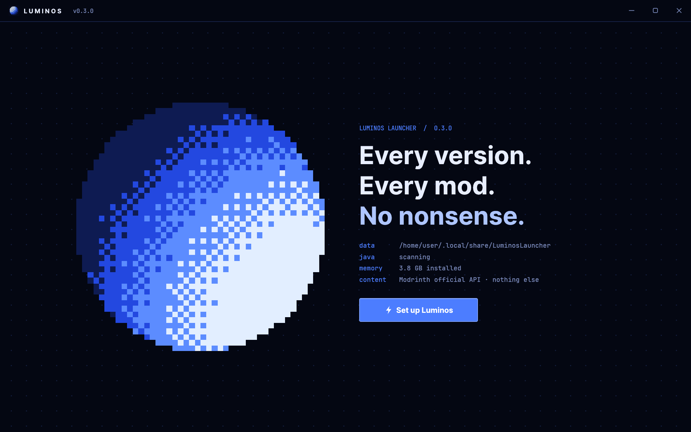
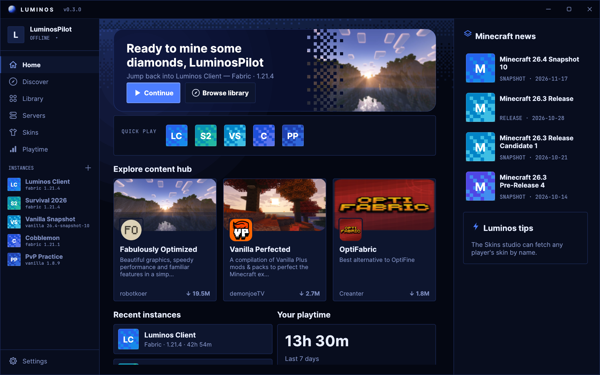
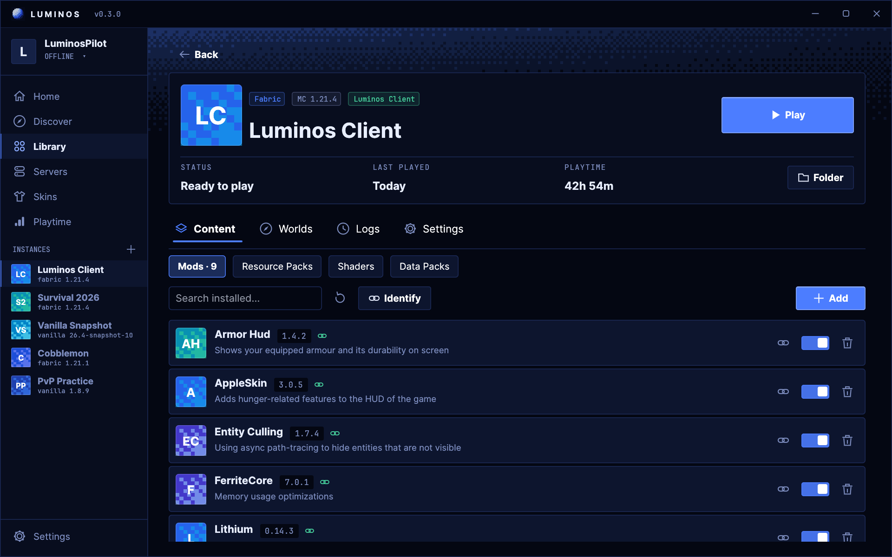
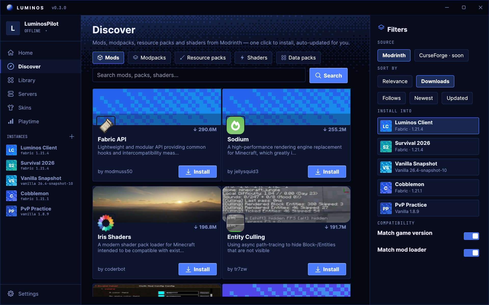

<p align="center"></p>

# Luminos

A fast Minecraft Java launcher with its own performance client built in. Written entirely in Rust, ~11 MB, no Electron.
Content comes from **Modrinth**, game files from **Mojang** — nothing else is contacted.

**[Download Luminos-Setup.exe](https://github.com/prashantchataut/Luminos/releases/latest/download/Luminos-Setup.exe)** · [Website](https://prashantchataut.github.io/Luminos/) · [Release notes](docs/RELEASE_NOTES.md)

> Windows may show "unknown publisher" because the app isn't code-signed yet. It is a reputation warning, not a detection — see
> [`docs/WINDOWS_SECURITY.md`](docs/WINDOWS_SECURITY.md) for how to verify the download.

| | |
|---|---|
|  |  |
|  |  |

*Every image is rendered by the launcher's own UI code (`luminos-shots`), not a mock-up.*

## What it does
- **Mod library** — search Modrinth for mods, modpacks, shaders, resource and data packs; dependencies resolved; `.mrpack` import.
- **Auto-update / unlink** — update one mod or a whole instance via hash lookup; unlink to pin a version.
- **Isolated instances** — own mods, saves, configs, RAM and Java. Fabric, Quilt and Vanilla launch today.
- **Luminos Client** — one box in setup builds a Fabric instance with Sodium, Lithium, Entity Culling, FerriteCore, ImmediatelyFast, Mod Menu … plus our own HUD mod (Armor HUD, keystrokes, CPS, FPS, coordinates, potions, toggle sprint, zoom, drag-and-drop HUD editor).
- **Crash doctor**, **world backups**, **server hub**, **playtime tracking**, **skin studio**, smart Java detection / runtime download, safe JVM flags.

## Repository
| Path | What |
|---|---|
| `launcher/crates/luminos-core` | headless engine |
| `launcher/crates/luminos-app` | egui desktop UI, `luminos-shots` (screens → PNG), `luminos-brand` (logo assets) |
| `client/` | Luminos Client Fabric mod (Java) |
| `installer/` | Inno Setup script → `Luminos-Setup.exe` |
| `site/` | GitHub Pages website (Vite + React) |
| `docs/` | research, release notes, security notes, agent skills |
| `CONTINUITY.md` | **session log — read first** · `AGENTS.md` rules for AI agents |

## Build
```bash
cd launcher && cargo run --release -p luminos-app --bin luminos     # the launcher
cargo run -p luminos-app --release --bin luminos-shots -- ../docs/screenshots   # renders
cargo run -p luminos-app --release --bin luminos-brand                  # regenerate logo assets (run from repo root)
```
End-to-end launch check (real game, needs a Java path): `LUMINOS_SMOKE_JAVA=… cargo test -p luminos-core --test launch_smoke -- --ignored --nocapture`
(`LUMINOS_SMOKE_LOADER=fabric`, `LUMINOS_SMOKE_PRESET=1` for the full client).

## License
Proprietary, all rights reserved — source is visible for evaluation and bug reports, but may not be copied, forked for redistribution or reused. See [`LICENSE`](LICENSE) and [`THIRD_PARTY_NOTICES.md`](THIRD_PARTY_NOTICES.md).
Luminos is not affiliated with Mojang or Microsoft. Minecraft is their trademark.
