# feat: Luminos Launcher foundation (session 1)

A complete foundation for a Rust Minecraft launcher: engine, UI, setup experience, mod library, skins, playtime, CI, site.
See [`CONTINUITY.md`](../CONTINUITY.md) for the full status table and next steps.

## What you can see (rendered from the real UI by `luminos-shots`)

### First-run setup
| Welcome | Profile |
|---|---|
| 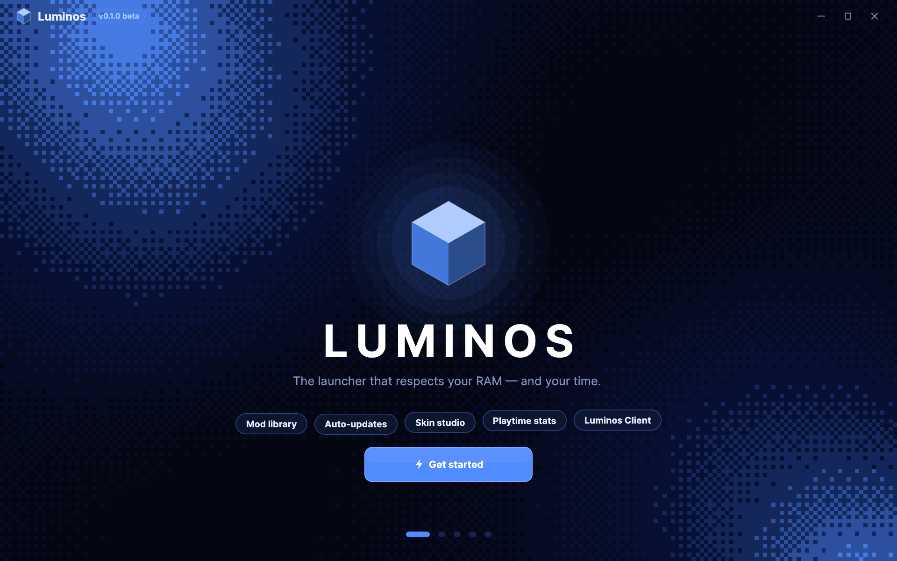 | 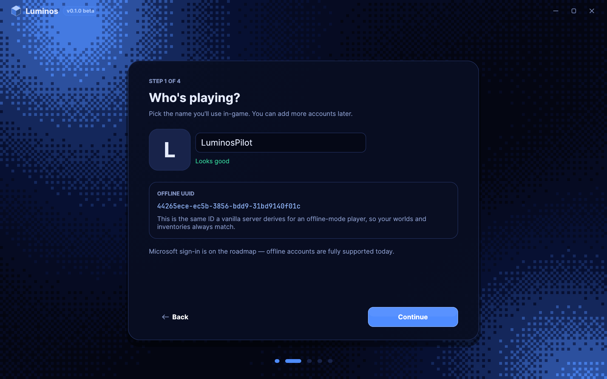 |
| **Performance** | **Choose client** |
| 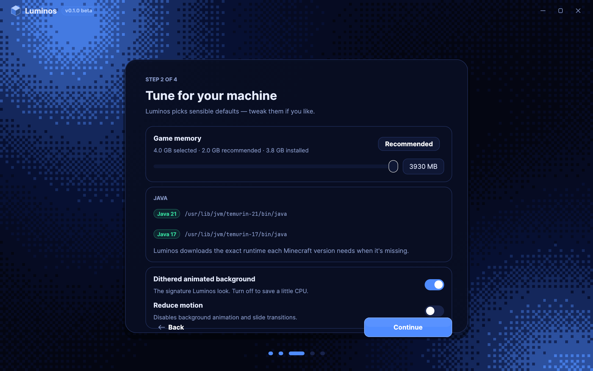 | 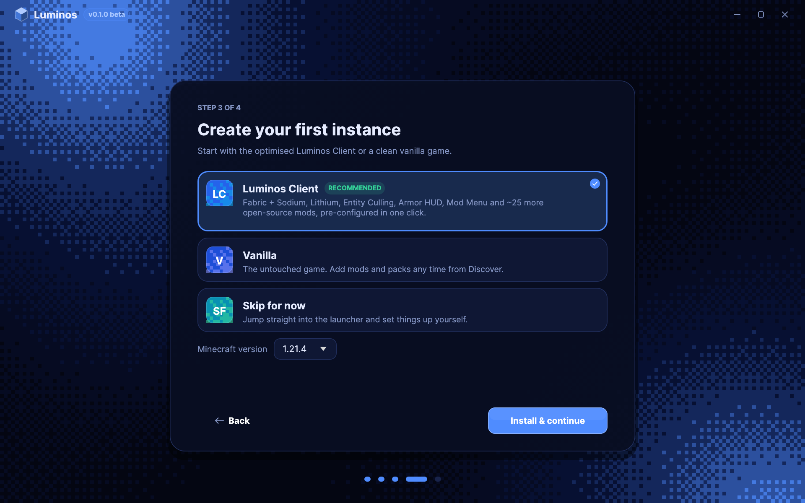 |
| **Install** | |
| 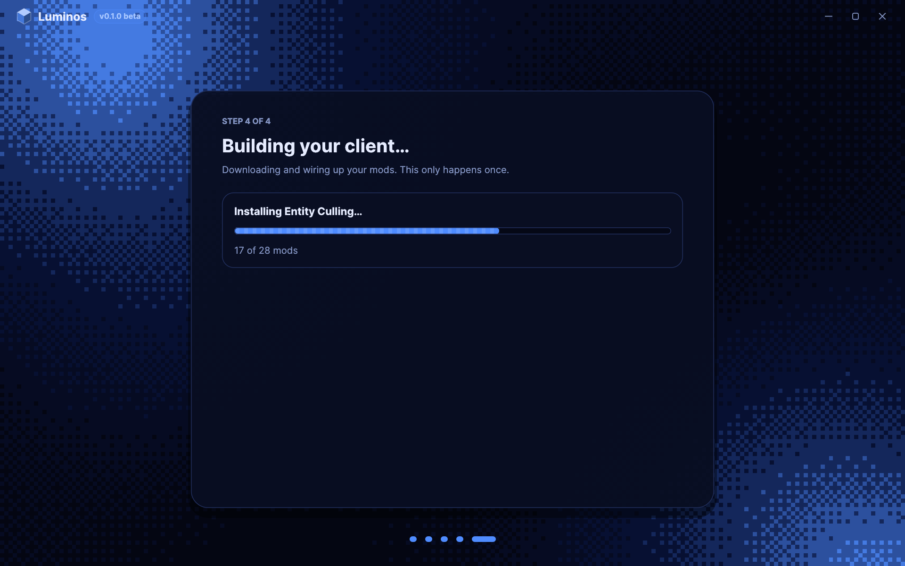 | |

### Main app
| Home | Library |
|---|---|
| 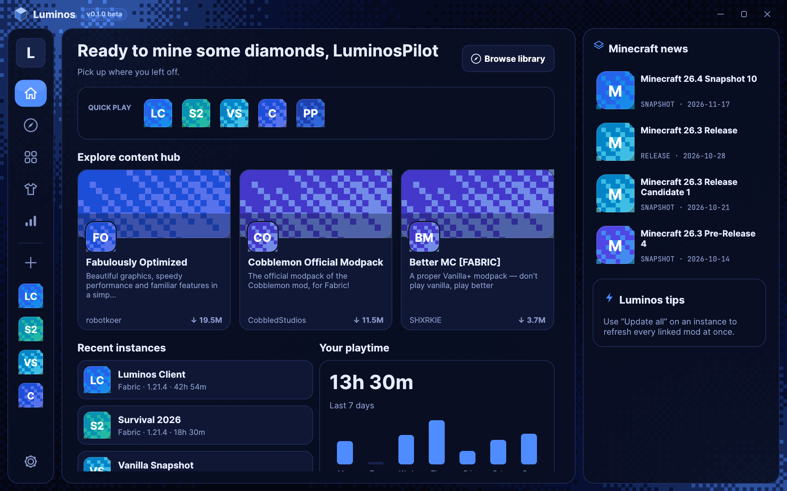 | 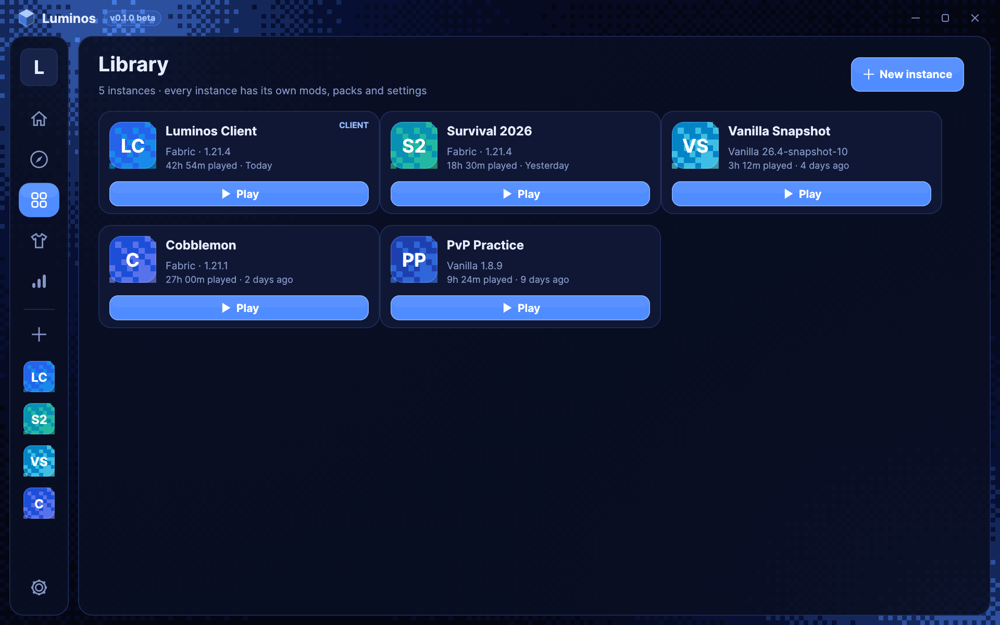 |
| **Instance (content)** | **Discover** |
| 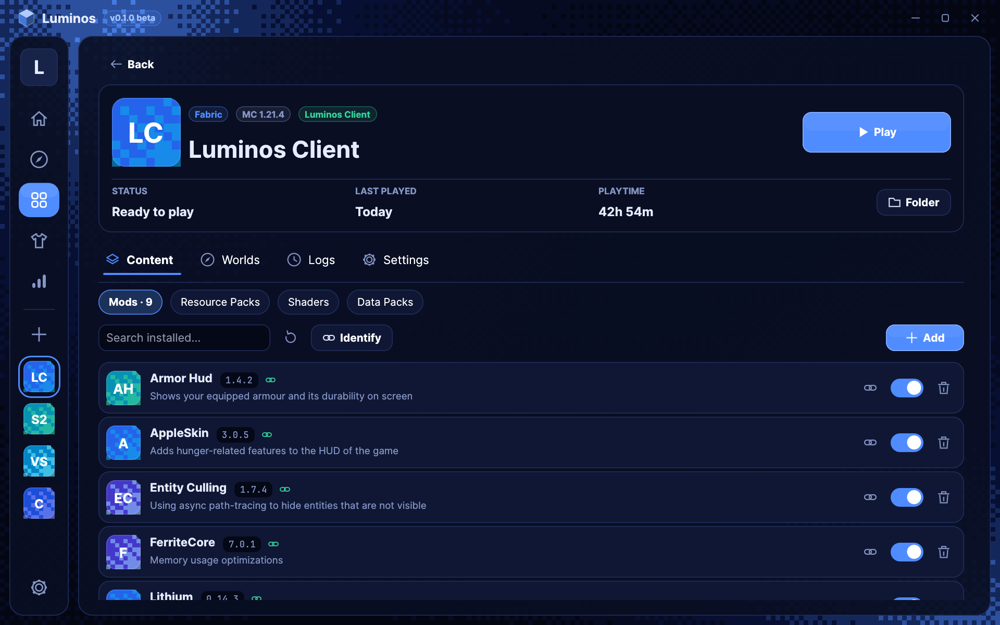 | 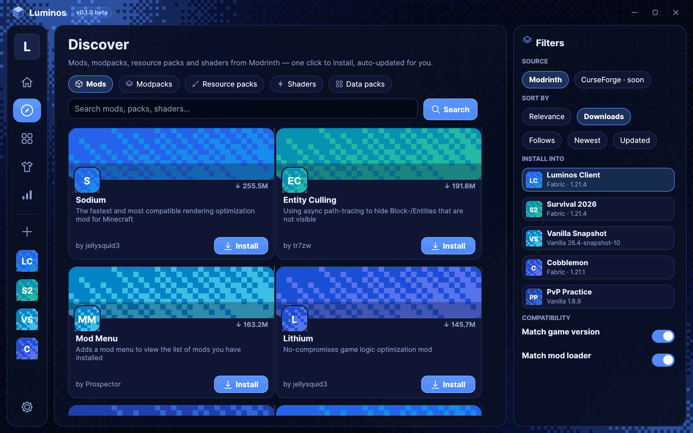 |
| **Skins library** | **Skin studio** |
| 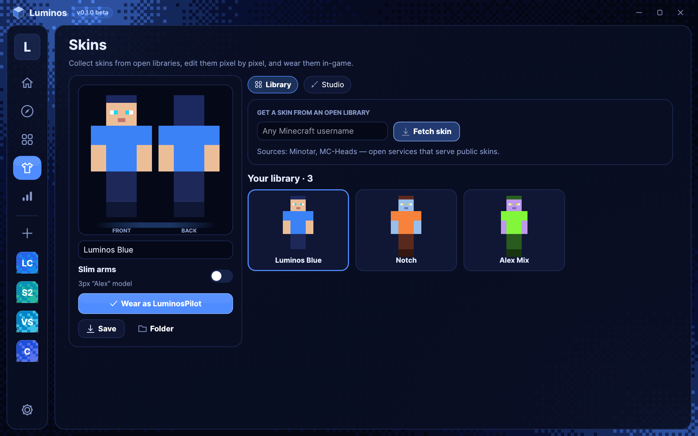 | 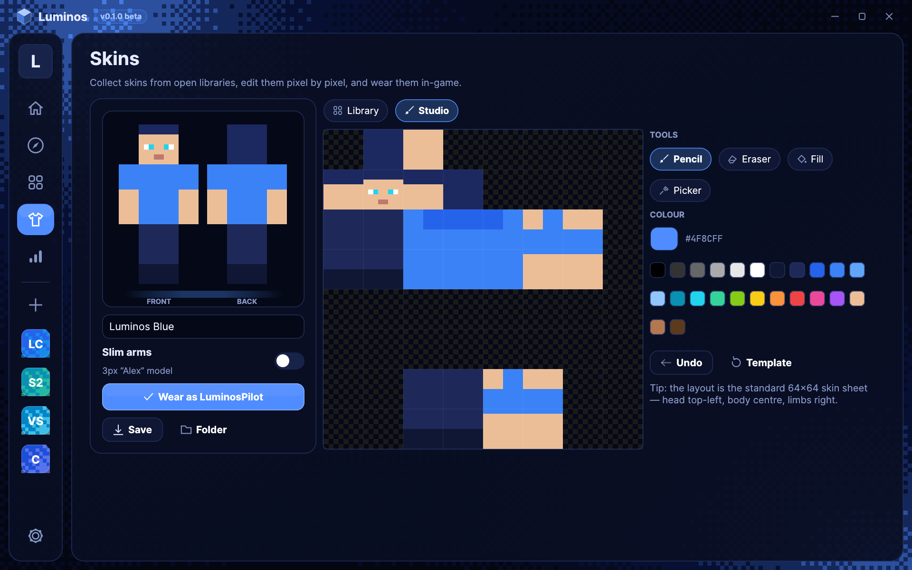 |
| **Playtime** | **Settings** |
| 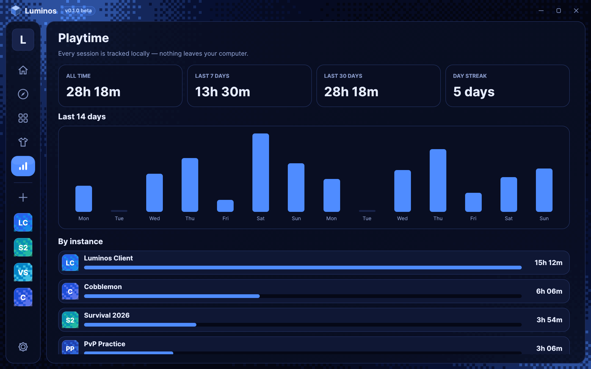 | 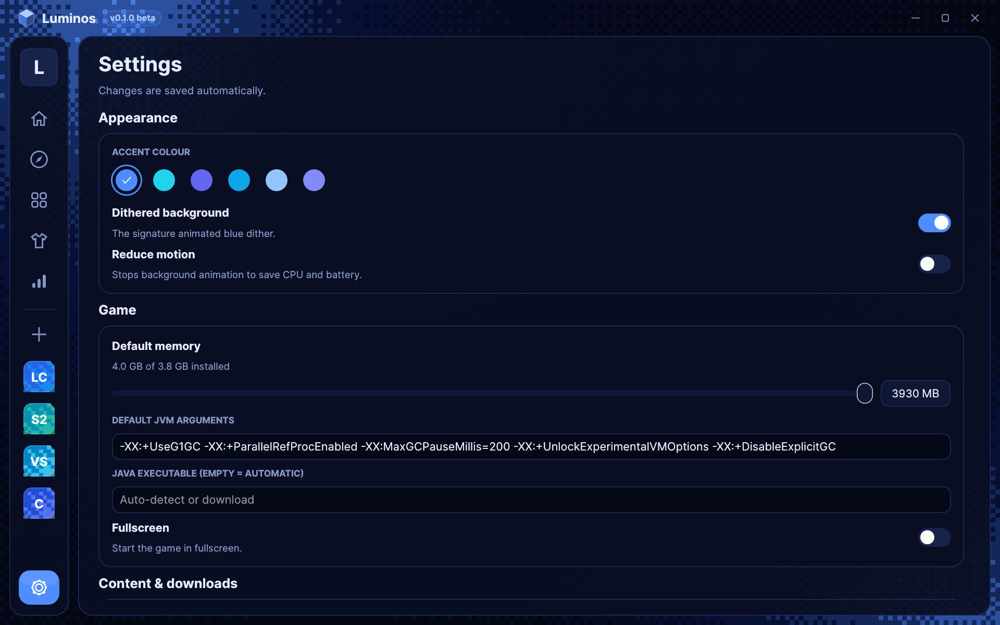 |
| **New instance** | **Launching** |
| 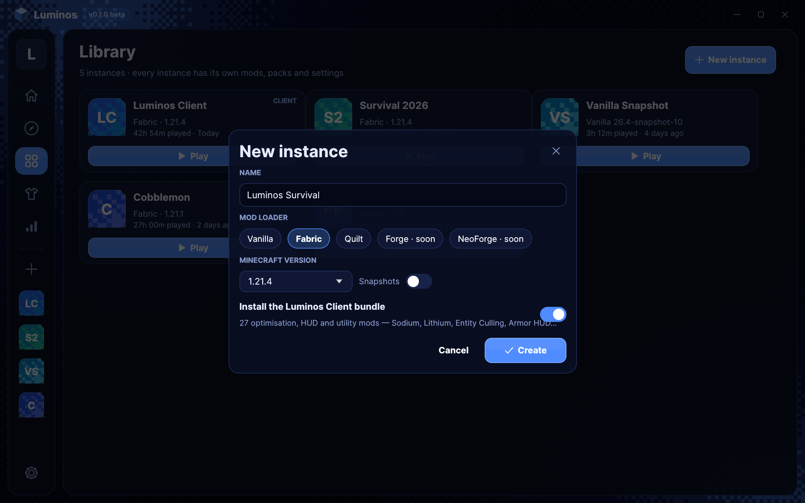 | 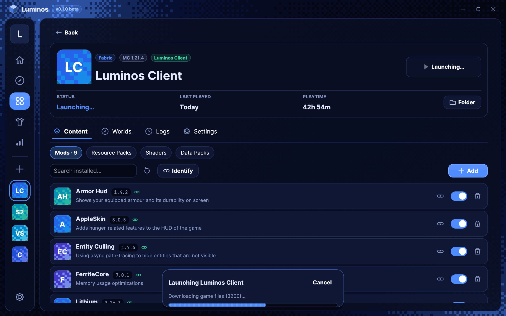 |

## Verification
- `cargo check --workspace` ✅ · `cargo test -p luminos-core` ✅ (4 unit tests)
- Live API tests ✅ (5): Mojang manifest, Fabric profile merge, Modrinth search/versions, every Luminos Client slug exists, news feed
- Release build ✅ (~11 MB) · 15 screens rendered headlessly ✅
- **Not yet verified:** an actual game launch on a desktop with a JVM; Windows/macOS window chrome. Marked 🟡 in CONTINUITY.

## Notes for reviewers
- No tokens or secrets in the repo. (A GitHub PAT was pasted in chat during development — **revoke it** and use a fine-grained token or `gh auth login`.)
- Forge/NeoForge and Microsoft login are intentionally not in this PR (see roadmap).
